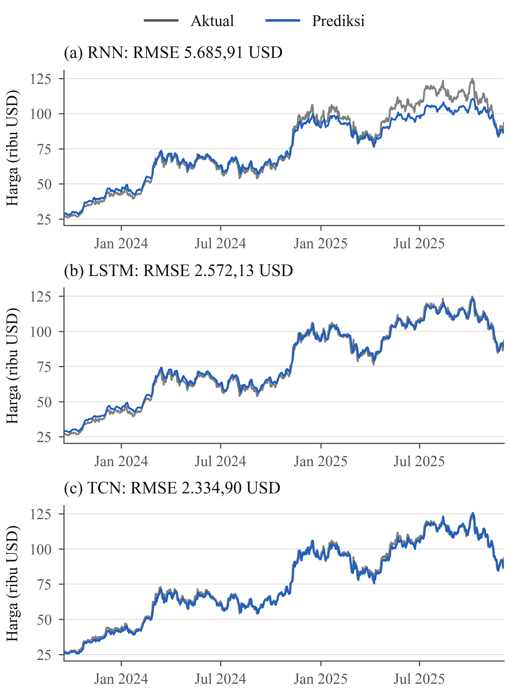

# Prediksi Harga Bitcoin: RNN, LSTM, dan TCN vs Baseline

Perbandingan tiga arsitektur deep learning untuk memprediksi harga penutupan BTC-USD satu hari ke depan, lalu pengujian semuanya terhadap baseline yang paling sederhana: harga besok sama dengan harga hari ini.

**Hasil utama:** TCN adalah yang terbaik di antara ketiga model, tetapi tidak satu pun dari 15 run model mengalahkan baseline pada periode test ini.



## Hasil

Evaluasi memakai 808 target test kronologis, dari 18 September 2023 hingga 3 Desember 2025. Nilai model adalah rata-rata ± simpangan baku dari lima random seed. Baseline bersifat deterministik, sehingga hanya memiliki satu nilai.

| Model | RMSE (USD) | MAE (USD) | sMAPE (%) | Parameter |
|---|---|---|---|---|
| Baseline persistence | **1.913,46** | **1.347,06** | **1,785** | – |
| TCN | 3.180,83 ± 619,28 | 2.450,17 ± 459,59 | 3,320 ± 0,579 | 13.217 |
| LSTM | 4.908,63 ± 1.212,85 | 3.920,78 ± 988,82 | 4,839 ± 0,990 | 18.977 |
| RNN | 7.378,45 ± 1.348,87 | 5.482,11 ± 891,13 | 6,267 ± 0,878 | 5.537 |

- RMSE rata-rata TCN 35,2% lebih rendah daripada LSTM dan 56,9% lebih rendah daripada RNN.
- Run terbaik TCN (RMSE 2.334,90 USD) masih 22,0% lebih buruk daripada baseline.
- Urutan model bisa berubah menurut seed: pada seed 1234, LSTM mengungguli TCN.
- Grafik prediksi yang tampak menempel pada harga aktual belum berarti model berguna, karena baseline tanpa pelatihan menghasilkan error lebih rendah.

Temuan ini hanya berlaku untuk konfigurasi dan periode yang diuji, jadi tidak membuktikan bahwa harga Bitcoin sama sekali tidak dapat diprediksi.

## Metode

- **Data:** harga harian BTC-USD dari Yahoo Finance, 17 September 2014 hingga 4 Desember 2025 (4.097 observasi).
- **Fitur:** harga penutupan serta sinus dan kosinus untuk tahun dan bulan.
- **Input:** window 60 hari dengan 5 fitur, dibagi kronologis menjadi 3.228 sampel train dan 808 sampel test.
- **Pelatihan:** Adam, MSE, 30 epoch, batch 32, dan seed 42, 123, 1234, 2023, 9999.
- **Interpretabilitas:** SHAP pada TCN, t-SNE pada lapisan laten, dan aktivasi lapisan konvolusi pertama TCN.

## Keterbatasan

- Target berupa harga mentah, dan 56,5% harga setelah batas fit scaler melebihi harga tertinggi data fit.
- Evaluasi hanya memakai satu periode test, belum walk-forward validation.
- Tidak ada penyetelan hyperparameter atau eksperimen tanpa fitur siklis.
- Run untuk grafik dan interpretabilitas dipilih dari RMSE test, jadi cenderung optimistis.
- SHAP hanya memakai 3 sampel test, sehingga hasilnya bersifat indikatif.

Pembahasan lengkapnya ada di [paper](paper_ieee_latex/paper_ieee_latex.pdf) (Bahasa Indonesia, format IEEE).

## Struktur repo

```text
├── code-fp.ipynb            Notebook utama, dengan output run penuh
├── requirements.txt         Versi pustaka yang dipakai saat run
├── paper_ieee_latex/
│   ├── paper_ieee_latex.pdf Paper
│   ├── main.tex             Sumber LaTeX (kompilasi dengan pdfLaTeX)
│   └── figures/             Grafik untuk LaTeX
└── paper_figures/
    ├── capture_figdata.py   Menjalankan salinan notebook dan menyimpan data grafik
    ├── figdata.npz          Data di balik grafik paper
    ├── make_figures.py      Menggambar grafik paper
    └── png/                 Grafik dalam PNG
```

## Cara menjalankan

Dipakai dan diuji dengan Python 3.10.11 pada CPU.

```bash
pip install -r requirements.txt
```

Buka `code-fp.ipynb` di Jupyter atau VS Code, lalu jalankan semua sel. Di CPU yang dipakai, satu run penuh memakan waktu sekitar 6–7 menit. Notebook mengunduh datanya sendiri lewat `yfinance`, jadi perlu koneksi internet.

Grafik paper bisa digambar ulang dari data tersimpan (butuh font Times New Roman):

```bash
cd paper_figures
python make_figures.py
```

Untuk mengambil ulang data grafik dari awal:

```bash
cd paper_figures
python capture_figdata.py
```

## Reproduksibilitas

Output tersimpan berasal dari run pada 6 November 2026. Run ulang pada 7 November 2026 di komputer yang sama menghasilkan RMSE dan sMAPE per seed yang identik. Hasil bisa berbeda di perangkat atau versi pustaka lain, atau kalau Yahoo Finance merevisi datanya. Waktu pelatihan juga berubah-ubah, jadi hanya berlaku untuk perangkat yang dipakai.

## Tim

Proyek ini berawal dari tugas kelompok mata kuliah di Sains Data, Institut Teknologi Sepuluh Nopember. Versi ini menambahkan baseline persistence, menjalankan ulang seluruh eksperimen, dan menulis ulang paper.

- Muhammad Farras
- Nandana Bahaghani
- Althaf Syakir
- Iqdam Shidqi
- Putri Amalia

## Lisensi

Kode dan isi repo ini memakai [lisensi MIT](LICENSE).
